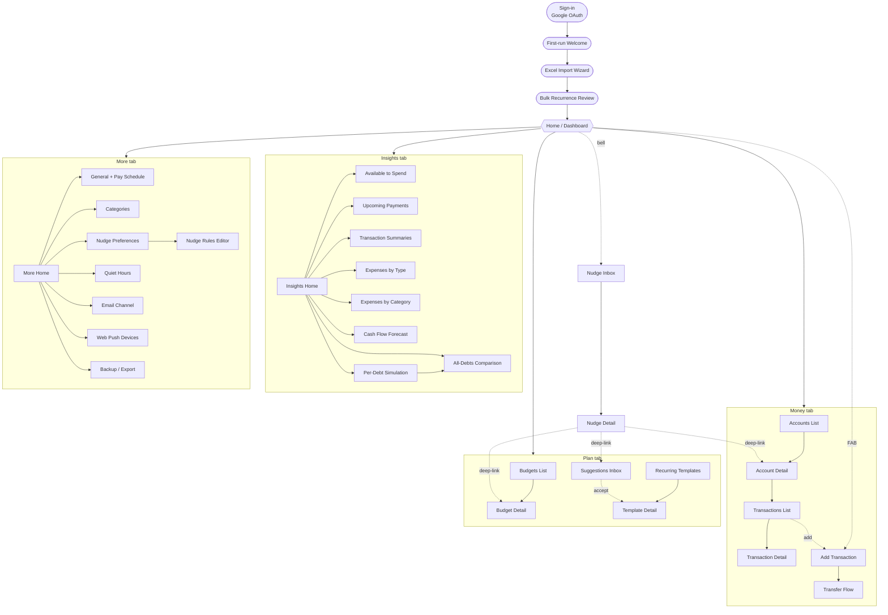

# MyBudgetApp — Screen Architecture

A working schema of the screens to design in Figma, derived from the project brief. Intended to lock the inventory and navigation before drawing pixels. Mobile-first; desktop is the same screens reflowed.

---

## 1. Navigation model

**Primary nav: 5-tab bottom bar (mobile) / left rail (desktop)**

| Tab | Purpose | Houses |
|---|---|---|
| **Home** | The day-to-day glance | Dashboard cards |
| **Money** | What I have, what I owe | Accounts + Transactions |
| **Plan** | What's set up and pending | Budgets + Recurring templates + Suggestions |
| **Insights** | What the data says | Reports + Forecast + Simulation |
| **More** | Everything else | Settings + Backup + About |

**Persistent header elements**
- **Bell icon** → Nudge inbox (badge with unread count). Surfaces from every screen.
- **+ button** (FAB on mobile) → Add Transaction (the most-used action).

Nudges intentionally live in the header rather than a primary tab — they should feel like an ambient layer, not a destination.

---

## 2. Screen map



Render this anywhere mermaid is supported — GitHub markdown viewer, VS Code with the Mermaid extension, or paste into [mermaid.live](https://mermaid.live) for an SVG export.

---

## 3. Screen inventory

Grouped by area. Each row is a screen to create as a Figma frame. The "key content" column lists the structural elements — not a design spec, just what data lives there.

### 3.1 Onboarding (one-time)

| Screen | Purpose | Key content |
|---|---|---|
| Sign-in | Google OAuth entry | Google sign-in button, app name, one-line tagline |
| First-run Welcome | Set expectations, pick currency | Welcome message, currency confirm (GBP), pay-schedule setup (frequency + anchor date) |
| Excel Import Wizard | Map and ingest Excel files | Step 1: upload Transactions XLSX. Step 2: column mapping (Excel column → app field). Step 3: dry-run preview with row count + warnings. Step 4: confirm. Repeat for Accounts XLSX |
| Bulk Recurrence Review | Triage suggestions surfaced by §6.7 | List of `RecurrenceSuggestion` rows with confidence, payee, amount, frequency. Per-row: Accept / Edit then accept / Dismiss |

### 3.2 Home

| Screen | Purpose | Key content |
|---|---|---|
| Dashboard | The morning glance | Cards: Available to spend (until next pay day), Net position, Upcoming payments (next 7 days), Latest nudges (top 3), Budgets-at-risk, Debt-free date countdown. Cards reorderable (later) |

### 3.3 Money tab

| Screen | Purpose | Key content |
|---|---|---|
| Accounts List | All accounts at a glance | Grouped by type (current / savings / credit card / loan). Per row: name, current balance, available credit for cards. Aggregate net position at top |
| Account Detail | One account deep | Header: name, type, current balance, APR & credit limit (credit cards), APR & principal (loans). Tabs: Transactions / Settings. Recent transactions inline |
| Transactions List | Browse and filter activity | Filters: account, category, type, date range, search. Grouped by date. Per row: payee, category, amount, account |
| Transaction Detail | Single transaction view/edit | All fields editable. Show `recurrence_template_id` link if recurring. Status pill (scheduled / posted / cleared) |
| Add Transaction | Modal/sheet — primary action | Date, amount, direction, account, category, type, description, recurring toggle. Compact and fast |
| Transfer Flow | Move between accounts | Source account, destination account, amount, date, description. Creates paired transactions with same `transfer_id` |

### 3.4 Plan tab

| Screen | Purpose | Key content |
|---|---|---|
| Budgets List | Budgets at a glance | Per budget: scope (overall / category), period, spent / limit, progress bar. New-budget button |
| Budget Detail | Single budget vs spend | Progress bar, spend breakdown, trend vs prior periods, edit budget |
| Recurring Templates | All auto-posting templates | Grouped by frequency or by account. Per row: payee, amount, next due date, source (manual / detected), active toggle |
| Template Detail | Single template edit | All fields. Linked transactions list. Skip-next-instance button |
| Suggestions Inbox | Pending suggestions to triage | Same as bulk review screen but for incremental incoming. Empty state when none pending |

### 3.5 Insights tab

| Screen | Purpose | Key content |
|---|---|---|
| Insights Home | Index of available reports | Grid of cards, each a preview of its own report screen |
| Available to Spend | Detailed view of the dashboard card | Headline figure, contributing outflows list, days to next pay day |
| Upcoming Payments | All scheduled outflows ahead | Tabs: Tomorrow / This week / This month / Annual. Per row: payee, amount, account, date |
| Transaction Summaries | Aggregated activity over time | Toggle: day / week / month / year. Bar or line chart + table |
| Expenses by Type | Split by transaction type | Donut + table. Direct debits, card repayments, loan repayments, regular upkeep, other |
| Expenses by Category | Split by category | Donut + table. Drill into each category opens filtered Transactions List |
| Cash Flow Forecast | Forward projection per §7.8 | Line chart (projected balance over horizon). Per-pay-cycle table below. Liquidity-alert markers on chart. What-if input |
| Per-Debt Simulation | One debt drilldown per §7.7 | Balance curve, payoff date, total interest. What-if controls: extra £/month, lump sum, change scheduled repayment |
| All-Debts Comparison | Strategy comparison per §7.7 | Side-by-side: Avalanche / Snowball / Even-spread / Custom. Per strategy: debt-free date, total interest, stacked balance curve |

### 3.6 Nudges (header bell, not a tab)

| Screen | Purpose | Key content |
|---|---|---|
| Nudge Inbox | All nudges, sortable | Tabs: New / Seen / Acted / Dismissed. Per row: severity dot, type icon, title, body, time, action button |
| Nudge Detail | Single nudge with full context | Title, body, severity, context JSON rendered nicely, action button (deep-link to relevant screen), dismiss, mark-acted |

### 3.7 More tab

| Screen | Purpose | Key content |
|---|---|---|
| More Home | Index of settings + utilities | Grouped list: Profile, Notifications, Data, About |
| General + Pay Schedule | Core settings | Pay frequency, anchor date, currency (display only), reporting week start, forecast horizon days, detection confidence threshold |
| Categories | Manage categories | List with default + custom. Add / rename / delete (with reassign-existing flow) |
| Nudge Preferences | Per-type enable & severity | Table: nudge type | enabled toggle | severity override |
| Nudge Rules Editor | Full rules engine UI | Three sections (Routing / Throttling / Escalation). Per rule: name, priority, when (JSON-ish editor), then (action), active toggle, drag-to-reorder. Add-rule button per axis |
| Quiet Hours | When to suppress non-alerts | Start time, end time, days-of-week selector |
| Email Channel | Email delivery config | Email address (defaults to Google), digest mode (immediate / daily morning / weekly), digest time |
| Web Push Devices | Manage subscribed devices | List of `PushSubscription` rows: device label (editable), created date, last used, active toggle, revoke button. "Subscribe this device" CTA if not subscribed |
| Backup / Export | Data exports | Last backup timestamp, "Export now" button, download recent JSON snapshots list |

---

## 4. Key user flows to wireframe first

Five flows worth designing end-to-end before fanning out to every screen. These exercise the model.

1. **First-run import** — Sign-in → First-run Welcome → Excel Import Wizard → Bulk Recurrence Review → Dashboard. Stress-tests the column-mapping UI and the suggestion-triage UX.
2. **Add a transaction** — Dashboard → FAB → Add Transaction → return to Dashboard (or wherever launched from). Should be ≤4 taps for the common case.
3. **Respond to a nudge** — Bell → Nudge Inbox → Nudge Detail → deep-link to action (e.g. Budget Detail or Suggestions Inbox) → resolve → back. Tests the deep-link surface.
4. **Run a debt what-if** — Insights → Per-Debt Simulation → adjust extra-£/month slider → see updated payoff date → save scenario or just observe. Tests the live-recalculation chart.
5. **Add a nudge rule** — More → Nudge Preferences → Nudge Rules Editor → add a routing rule → confirm priority placement → save. Tests whether the rules editor is actually usable or needs simplification.

Get these five right first; the other 25 screens are mostly variations on patterns these flows establish.

---

## 5. Suggested Figma file structure

Mirror the tab structure so navigation is obvious when you open the file later.

```
MyBudgetApp/
├── 00 — Foundations
│   ├── Colors
│   ├── Typography
│   ├── Spacing & grid
│   ├── Components (buttons, cards, list rows, modals, charts)
│   └── Icons
├── 01 — Onboarding
├── 02 — Home
├── 03 — Money
├── 04 — Plan
├── 05 — Insights
├── 06 — Nudges
├── 07 — More (Settings)
├── 08 — Empty / Loading / Error states
└── 09 — Flows (the five key flows from §4, as connected prototypes)
```

Couple of practical notes:
- Build **Foundations** first. Card, list row, header, FAB, bottom tab bar, modal — these recur on nearly every screen. Designing them once saves a lot of rework.
- Mobile width: 390px (iPhone 14/15) is a reasonable canonical width. Add a desktop frame (1280–1440px) for one or two screens to confirm the responsive intent — don't reflow every screen until the mobile pass is locked.
- The orbital token file you have already maps onto Foundations directly (colours, typography, spacing, radii) — design tokens first, components second.

---

## 6. Modal vs full-screen guidance

Some judgement calls worth making once and applying consistently:

| Pattern | When to use | Examples here |
|---|---|---|
| **Full screen** | Distinct destination; user reasons about it on its own | Dashboard, lists, details |
| **Sheet (bottom modal)** | Quick action that returns to context | Add Transaction, Transfer, edit-template-amount |
| **Dialog (centred modal)** | Confirmation, single decision | Delete confirm, dismiss-nudge confirm, restore-from-backup |
| **Inline edit** | Trivial single-field change without losing context | Rename category, toggle template active |

Add Transaction as a **sheet** rather than a full screen is the single biggest UX decision here — it dictates how fast the most common action feels.

---

## 7. What this doesn't cover (yet)

Deliberately deferred until the inventory is approved:

- **Per-screen wireframes** — what each frame actually looks like, beyond the content cues above. Natural next step.
- **Component library spec** — exact props, states, and variants for cards, rows, charts.
- **Responsive desktop layout decisions** — which mobile screens become two-pane on desktop (probably Money and Insights), which stay single-pane.
- **Empty / loading / error states** — the third dimension. One placeholder page for these in §08; populate as you build each screen.
- **Accessibility passes** — contrast, tap targets, screen-reader labels. Worth a dedicated review once the visual style is set.

